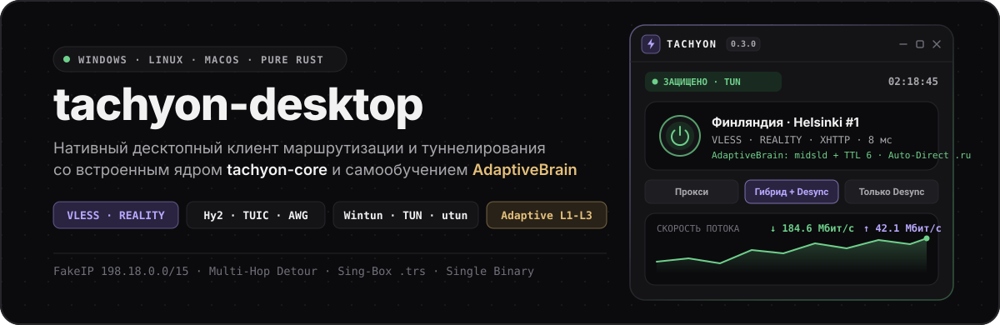
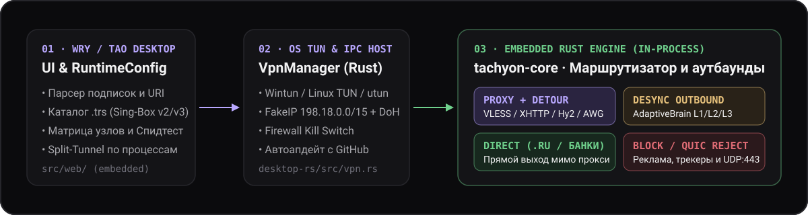

<div align="center">
  

  <br />

  <p>
    <a href="https://github.com/Dushnilin/tachyon-desktop/actions/workflows/build-desktop.yml"></a>
    <a href="https://github.com/Dushnilin/tachyon-desktop/releases"></a>
    <a href="https://github.com/Dushnilin/tachyon-core"></a>
    <a href="https://github.com/Dushnilin/tachyon-lists"></a>
    
  </p>
</div>

**tachyon-desktop** — кроссплатформенный десктопный клиент для **Windows**, **Linux** и **macOS**, написанный целиком на **Rust** (`Wry`/`Tao` + встроенное ядро [`tachyon-core`](https://github.com/Dushnilin/tachyon-core)). В одном нативном исполняемом файле объединены современные транспортные и туннельные протоколы (**VLESS REALITY**, **XHTTP**, **Hysteria2**, **TUIC v5**, **AmneziaWG**) и локальный самообучающийся движок адаптивной сегментации трафика (**AdaptiveBrain L1–L3**), обеспечивающий устойчивую сетевую связность как через удалённый шлюз, так и при прямом соединении.

### Скачать и обновить

Готовые сборки для всех трёх операционных систем публикуются в разделе [**GitHub Releases**](https://github.com/Dushnilin/tachyon-desktop/releases/latest):

| Платформа | Файл в релизе | Особенности запуска и установки |
| :--- | :--- | :--- |
| **Windows 10 / 11** (`x86_64`) | `Tachyon-windows-x86_64.exe`<br/>`Tachyon-windows-x86_64.zip` | Портативный одиночный `.exe` — драйвер `wintun.sys`, ядро `tachyon-core` и интерфейс уже вшиты внутрь бинарника (без внешних `.dll`). |
| **Linux** (`x86_64` / `amd64`) | `tachyon_0.3.5_amd64.deb`<br/>`tachyon-linux-amd64.tar.gz` | Пакет `.deb` для Ubuntu/Debian/Mint или архив с `install.sh` для Arch/Fedora. Автоматически выставляет `cap_net_admin,cap_net_raw+eip` через `setcap`. |
| **macOS 11+** (`Universal`) | `Tachyon-0.3.5-macOS.dmg` | Универсальный образ (`Apple Silicon M1–M4 + Intel x86_64`). Перетащите `Tachyon.app` в `Applications`. |

> **Автообновление из клиента:** в разделе **Опции → Движок и обновления** встроена прямая проверка релизов `Dushnilin/tachyon-desktop` через GitHub Releases API с загрузкой свежего бинарного файла под текущую ОС и атомарной заменой на лету.

---

## Чем отличается

- **Единый бинарник на чистом Rust (`Zero-C/FFI`):** клиент не зависит от `.NET`, Electron или внешних процессов `sing-box` / `xray`. Графическая оболочка (`Wry`/`Tao`), веб-ассеты, драйвер `Wintun` и сетевое ядро [`tachyon-core`](https://github.com/Dushnilin/tachyon-core) скомпилированы в один самодостаточный исполняемый файл.
- **Два независимых контура в одном окне:**
  1. **Защищённый туннель** (`VLESS REALITY`, `XHTTP`, `gRPC`, `WS`, `Hysteria2`, `TUIC v5`, `Trojan`, `VMess`, `Shadowsocks-2022`, `WireGuard`, `AmneziaWG`, `ShadowTLS v3`, `AnyTLS`) для шифрования потока и маршрутизации через внешние узлы.
  2. **Адаптивный шейпер пакетов (`AdaptiveBrain L1/L2/L3`)** на уровне TCP/UDP-сегментов (сегментация `ClientHello` по `midsld`/`sniext`, калибровочные пакеты с коротким TTL и `TCP MD5 Option 19`, преамбулы `UDP` для голосовых и STUN-сессий, управление `QUIC UDP:443`) для прямой оптимизации соединений на полной скорости канала без транзитного сервера.
- **Самообучение и контроль длинных сессий (`16–32 КБ`):** движок `AdaptiveBrain` автоматически перебирает 8 встроенных профилей сегментации при сбое рукопожатия, сохраняет оптимальный профиль для каждого узла в `cache.db` и контролирует стабильность передачи на первых 32 КБ потока.
- **Бинарные гео-базы `.trs` (`tachyon-lists`):** потоковая загрузка и проверка скомпилированных правил маршрутизации `Sing-Box SRS v2/v3` (`.trs`) для прямого соединения с российскими сайтами, банками и Госуслугами (`direct`) и селективной маршрутизации облачных платформ, ИИ-сервисов и медиа.
- **Каскадирование (`Multi-Hop Detour`) и 1-клик WARP:** возможность сцепить два узла в цепочку `Клиент → Входной узел → Выходной узел`, а также автоматическая генерация профиля **Cloudflare WARP (AmneziaWG)** прямо из интерфейса.

---

## Как устроен конвейер

<div align="center">
  
</div>

<br />

| Слой | Компонент | Роль в системе |
| :--- | :--- | :--- |
| **1. UI & IPC Host** | `desktop-rs/src/main.rs` + `src/web/` | Нативное окно без системных рамок (`Tao` + `Wry`), двухколоночный адаптивный интерфейс (Bento-сетка, тёмная графитовая `#0B0B0D` и светлая темы), парсинг подписок, пинг узлов и управление правилами. |
| **2. Сетевой стек ОС** | `desktop-rs/src/vpn.rs` | Поднятие виртуального сетевого интерфейса (`Wintun` на Windows, `/dev/net/tun` на Linux, `utun` на macOS) или системного HTTP/SOCKS5 прокси (`127.0.0.1:7897`), Firewall Kill Switch и автообновление. |
| **3. Встроенное ядро** | [`tachyon-core`](https://github.com/Dushnilin/tachyon-core) (`core-runtime`) | Исполняется непосредственно внутри процесса клиента (или в привилегированном воркере `--run-core`). Обрабатывает L3/L4-пакеты, `FakeIP` (`198.18.0.0/15`), сниффинг `TLS SNI` / `HTTP Host` и правила `.trs`. |
| **4. Аутбаунды** | `proxy` · `desync` · `direct` · `block` | Распределяет соединения между прокси-туннелем (с опциональным `detour`), адаптивным шейпером `AdaptiveBrain`, прямым сокетом для `.ru`/`.рф` и локальным фильтром рекламы и `QUIC`. |

---

## Возможности по разделам

### 1. Протоколы, подписки и мульти-хоп
- Импорт подписок по HTTPS-ссылкам (Base64, Clash YAML, Sing-Box JSON, текстовые списки) с извлечением заголовка `Subscription-Userinfo` (остаток трафика и срок действия).
- Прямой импорт одиночных ключей `vless://`, `vmess://`, `trojan://`, `ss://`, `hy2://`, `tuic://`, `wg://`, `amneziawg://`.
- Многокритериальный фильтр узлов (по протоколу, транспорту `WS`/`gRPC`/`XHTTP`/`TCP`, стране, пингу) и параллельный TCP/TLS-пинг.
- **Генератор Cloudflare WARP (AmneziaWG):** регистрация ключей `X25519` через API Cloudflare с обфускацией заголовков (`Jc/Jmin/Jmax/H1–H4`) в один клик.

### 2. Адаптивная сегментация трафика (`Tachyon Desync / AdaptiveBrain`)
- **8 встроенных профилей:** `Авто (AdaptiveBrain)`, `Мультимедиа + VoIP`, `Fake + Split`, `Fake + Disorder`, `TLS Record Split`, `Multi-Split`, `Split`, `Disorder`, `Только Fake`, `TCP OOB`.
- **Гибкая настройка:** метод маркировки проверочных сегментов (`TCP MD5 Option 19`, `badsum`, `badseq`), точка сегментации (`midsld`, `sniext`, `host`, смещение), TTL калибровочного пакета (`1–128`), настраиваемый профиль `sni` (`gosuslugi.ru`, `vk.com`, `ya.ru`, `ozon.ru`).
- **UDP и Голос:** отправка инициализирующих пакетов `STUN Binding Request` / `QUIC Initial` перед датаграммами для стабилизации WebRTC, голосовых каналов и сетевых игр.

### 3. Умная маршрутизация и `.trs`-списки
- **3 быстрых сценария:**
  - `Умный маршрут (РФ напрямую)` — российские сайты, банки и Госуслуги идут напрямую мимо туннеля с минимальным пингом; внешний трафик защищён.
  - `Селективный (По категориям)` — через туннель направляются только выбранные категории из каталога [`tachyon-lists`](https://github.com/Dushnilin/tachyon-lists) (`openai`, `claude`, `gemini`, `github`, `steam`, `spotify`, `youtube`, `discord`, `telegram`, `habr` и др.).
  - `Весь трафик (Глобальный)` — полное туннелирование всех соединений.
- **Split-Tunneling по приложениям:** привязка конкретных процессов (`.exe` на Windows, бинарников на Linux и `.app` на macOS) и доменов к нужному действию (`Через VPN`, `Напрямую`, `Каскад / Узел`, `Блокировать`).

### 4. DNS, FakeIP и диагностика
- **Зашифрованный DNS (DoH) + Раздельный DNS:** домены `.ru` / `.рф` резолвятся через быстрый российский DNS (`77.88.8.8`), а внешние — через защищённый резолвер внутри туннеля.
- **FakeIP (`198.18.0.0/15`):** мгновенный синтетический DNS-ответ, полностью исключающий утечки DNS и ускоряющий открытие сайтов.
- **Матрица сетевой связности и потоковый Спидтест:** параллельная диагностика доступности 10 целевых узлов (`Cloudflare`, `GitHub`, `OpenAI`, `Telegram`, `YouTube`, `Discord` и др.) и замер пропускной способности (`25` / `100` / `250` МБ) через `Cloudflare`, `Hetzner` и `OVH`.

---

## Сборка из исходников

Для сборки требуется установленный **Rust 1.85+** (`stable`). Исходный код ядра [`tachyon-core`](https://github.com/Dushnilin/tachyon-core) должен находиться в соседней директории `../tachyon-core`.

```bash
# Клонирование клиента и ядра рядом друг с другом
git clone https://github.com/Dushnilin/tachyon-core.git
git clone https://github.com/Dushnilin/tachyon-desktop.git
cd tachyon-desktop
```

### Windows (`x86_64`)

```powershell
cd desktop-rs
cargo build --release
# Готовый автономный файл: desktop-rs/target/release/tachyon.exe
```

### Linux (`Ubuntu / Debian / Arch / Fedora`)

```bash
# Зависимости WebKitGTK (Ubuntu 24.04 / Debian 12+)
sudo apt-get install -y libwebkit2gtk-4.1-dev libgtk-3-dev libayatana-appindicator3-dev librsvg2-dev pkg-config dpkg-dev

# Сборка .deb и портативного .tar.gz в папку ./dist/
chmod +x desktop-rs/scripts/package-linux.sh
./desktop-rs/scripts/package-linux.sh 0.3.1
```

### macOS (`Universal: Apple Silicon + Intel`)

```bash
rustup target add aarch64-apple-darwin x86_64-apple-darwin
chmod +x desktop-rs/scripts/package-macos.sh
./desktop-rs/scripts/package-macos.sh --universal 0.3.1
# Готовый образ: ./dist/Tachyon-0.3.1-macOS.dmg
```

---

## Связанные репозитории

- [**Dushnilin/tachyon-core**](https://github.com/Dushnilin/tachyon-core) — высокопроизводительное Pure-Rust ядро маршрутизации, туннелирования и адаптивной сегментации трафика (`AdaptiveBrain`).
- [**Dushnilin/tachyon-proxy**](https://github.com/Dushnilin/tachyon-proxy) — нативный клиент Tachyon для Android, Android TV и iOS (`Flutter` + `tachyon-core`).
- [**Dushnilin/tachyon-lists**](https://github.com/Dushnilin/tachyon-lists) — автоматически обновляемый каталог бинарных гео-баз и списков маршрутизации (`.trs`).

---

## 💖 Поддержать разработку

Если Tachyon помогает вам и делает работу в сети комфортной, вы можете поддержать проект и автора! ☕ 🧀 🌭

⭐ **Boosty (подписки, донаты, эксклюзив):**  
👉 [**Поддержать на Boosty**](https://boosty.to/tachyon)

💳 **Карты РФ / СБП / Tinkoff Pay:**  
👉 [**Поддержать проект на CloudTips**](https://pay.cloudtips.ru/p/449c5ef9)

🪙 **Криптовалюта:**
* **Bitcoin (BTC):** `bc1q9ehdv7y9g948jejyflkq7xmau3tytgunxgh35h`
* **Ethereum (ETH / ERC-20):** `0x6CB7a4547eD62EF64990D5C6B5D9fdA58EB223E6`
* **TON:** `UQDPhLRjMz5KltDLACAT3YXXHDVEtIDOHky2i33ZIOtsMEoR`
* **Solana (SOL):** `3csTGaNeU9KjhCKHEKAU3XLS5UfVjEeBVhXihpsETZwh`

---

## Правовая информация и отказ от ответственности

**Отказ от ответственности:**

1. **Назначение программного обеспечения.** `tachyon-desktop` (и встроенное ядро `tachyon-core`) является универсальным техническим средством маршрутизации сетевого трафика, балансировки нагрузки, диагностики сетевых соединений, обеспечения информационной безопасности и построения защищённых корпоративных и личных каналов связи (VPN).
2. **Соблюдение законодательства.** Программное обеспечение не создавалось, не предназначено и не распространяется для целей нарушения законодательства Российской Федерации (включая ФЗ № 149-ФЗ «Об информации, информационных технологиях и о защите информации») или законодательства любой иной юрисдикции, а равно для неправомерного получения доступа к информационным ресурсам, доступ к которым ограничен в соответствии с законом.
3. **Использование на собственный страх и риск.** Автор и правообладатель не предоставляют никаких прокси/VPN-серверов, узлов связи, подписок, ключей доступа или готовых списков маршрутизации. Программное обеспечение поставляется по принципу «КАК ЕСТЬ» (`AS IS`). Любая установка, настройка и эксплуатация программы осуществляются пользователем исключительно по собственной инициативе, на свой страх и риск и под свою полную единоличную ответственность. Правообладатель не несёт ответственности за действия пользователя, выбранные им конфигурации и любые последствия использования программного обеспечения.
